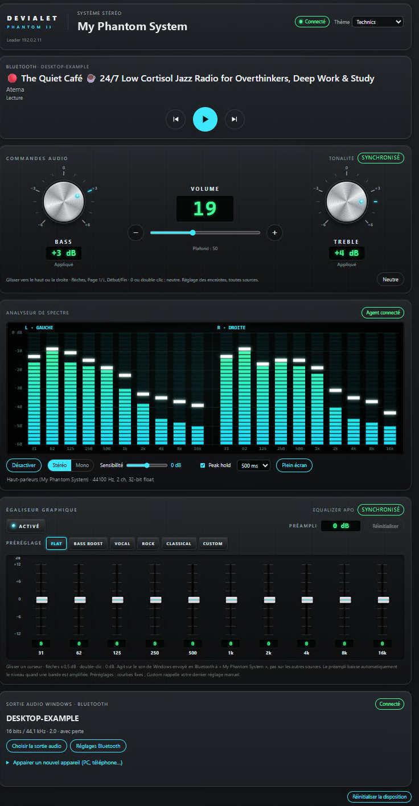

# devialet-web-controller

Contrôleur web local pour Devialet Phantom II.

Une console web locale pour piloter une **paire stéréo Devialet Phantom II** depuis Chrome ou Edge, sans cloud et sans l'application mobile. Elle couvre :
- volume, lecture, état des enceintes ;
- basses et aigus natifs ;
- sortie Bluetooth Windows ;
- analyseur de spectre ;
- égaliseur graphique 10 bandes via Equalizer APO.

> **Projet indépendant, non officiel.** Il n'est ni affilié à Devialet, ni approuvé, ni soutenu par Devialet. « Devialet » et « Phantom » sont des marques de Devialet.
>
> Il s'appuie sur l'API réseau locale non documentée des enceintes (« IP Control »). Une mise à jour de firmware peut la modifier ou la retirer sans préavis.
>
> Utilisation à vos risques (voir [Limites et risques](#limites-et-risques)).

<p align="center">
  
</p>

## Fonctions

- **Paire stéréo** :
  - découverte automatique ou adresses fixes ;
  - état des deux enceintes, leader, firmware ;
  - lecture, pause, piste précédente et suivante.
- **Volume** : plafonné à 50 sur 100, non contournable par l'API ; envois regroupés.
- **Tonalité native** : basses et aigus de −6 à +6 dB, appliqués aux deux enceintes.
- **Sortie audio Windows (Bluetooth)** :
  - appareil connecté et qualité du flux ;
  - mode d'appairage d'environ 2 minutes, avec un assistant.
- **Analyseur de spectre** : 10 bandes par canal, mesurées par un petit agent Windows en WASAPI Loopback. Les échantillons audio ne quittent pas l'agent.
- **Égaliseur graphique 10 bandes** :
  - fonctionne avec [Equalizer APO](https://sourceforge.net/projects/equalizerapo/), installé par vos soins ;
  - réglage de −12 à +12 dB par bande ;
  - préampli anti-écrêtage automatique ;
  - préréglages Flat, Bass Boost, Vocal, Rock, Classical et Custom ;
  - confirmation avant toute hausse de niveau de plus de 6 dB.
- **Interface** : quatre thèmes ; blocs réorganisables à la souris, au toucher et au clavier ; utilisable sur mobile.

## Sécurité : ce que le contrôleur fait et ne fait pas

- **Écoute uniquement sur `127.0.0.1` par défaut.** L'accès depuis d'autres appareils demande une configuration explicite, avec un jeton d'accès (voir [Accès depuis le réseau local](#accès-depuis-le-réseau-local)).
- **Écritures vers les enceintes sur liste blanche** : volume, lecture, mode d'appairage Bluetooth, basses et aigus. Toute autre commande est refusée avant l'envoi : pas de création ou suppression de paire, de changement de rôle, de réinitialisation, de mise à jour de firmware ni de réglage réseau.
- **Requêtes intersites bloquées.** Chaque requête d'écriture doit porter l'en-tête `X-Devialet-Request: 1`. Une page web tierce ne peut pas l'ajouter sans une prévérification CORS, que le serveur n'accorde jamais. Les origines étrangères sont refusées.
- **En-tête `Host` contrôlé** : il doit désigner cette machine, ce qui protège contre le *DNS rebinding*. Les pages refusent d'être affichées dans un cadre (protection contre le *clickjacking*).
- **Equalizer APO** :
  - le contrôleur n'écrit qu'**un seul fichier**, `devialet-eq.txt` ;
  - il l'écrit de façon atomique et ne l'écrase jamais s'il a été modifié à la main ;
  - il ne touche jamais `config.txt` ;
  - aucun chemin ni aucune directive libre n'est accepté depuis HTTP.
- **Aucun secret.** L'API locale des enceintes n'a **aucune authentification**. Tout appareil de votre réseau peut déjà la piloter directement : le contrôleur n'ajoute pas ce risque, mais ne le supprime pas non plus.

**N'exposez jamais ce serveur sur Internet** (redirection de port, tunnel, proxy public).

## Prérequis

- Deux Phantom II en paire stéréo sur le réseau local. Le contrôleur a été validé avec le firmware DOS 2.19.1, qui doit être ≥ 2.18 pour exposer IP Control.
- Python ≥ 3.10 ; testé avec 3.12. Le contrôleur a été développé sous **WSL2** (Ubuntu) et piloté depuis un navigateur Windows. Il fonctionne aussi sous Linux.
- Facultatif :
  - Node.js ≥ 18, pour les tests JavaScript ;
  - Windows avec .NET Framework 4, pour l'agent de l'analyseur ;
  - Equalizer APO, pour l'égaliseur graphique.

## Installation

```bash
git clone https://github.com/Pat-Vdv/devialet-web-controller.git
cd devialet-web-controller
python3 -m venv .venv
.venv/bin/pip install -r requirements.txt -c constraints.txt      # versions testées
```

## Lancement

```bash
# adresses fixes (remplacez par les IP de VOS enceintes ; 192.0.2.x sont des adresses d'exemple)
.venv/bin/python -m devialet_web --hosts 192.0.2.10,192.0.2.11

# ou découverte automatique sur votre sous-réseau privé (au plus /22) ; un cache est ensuite gardé
.venv/bin/python -m devialet_web --subnet 192.168.1.0/24
.venv/bin/python -m devialet_web --subnet 192.168.1.0/24 --discover-only   # test, sans serveur
```

Ouvrez ensuite **http://localhost:8000**. Sous WSL2 en mode NAT, `localhost` est relayé de Windows vers WSL : le navigateur Windows y accède directement.

**Options principales** (chacune a une variable d'environnement, voir [`examples/devialet.env.example`](examples/devialet.env.example)) :

| Option | Variable | Défaut |
|---|---|---|
| `--hosts` | `DEVIALET_HOSTS` | — |
| `--subnet` | `DEVIALET_SUBNETS` | — |
| `--max-volume` | `DEVIALET_MAX_VOLUME` | 50 (plafond) |
| `--port` | `DEVIALET_PORT` | 8000 |
| `--bind` | `DEVIALET_BIND` | `127.0.0.1` |
| `--eapo-config` | `DEVIALET_EAPO_CONFIG` | `/mnt/c/Program Files/EqualizerAPO/config` ; une chaîne vide désactive l'égaliseur |
| `--cache` | `DEVIALET_CACHE` | `~/.config/devialet-web/known_speakers.json` |

Les adresses, noms et identifiants de vos appareils restent dans votre environnement ou dans le cache local : **ne les ajoutez pas au dépôt**.

### Accès depuis le réseau local

Désactivé par défaut. Pour l'activer en connaissance de cause :

```bash
export DEVIALET_ACCESS_TOKEN="$(python3 -c 'import secrets; print(secrets.token_urlsafe(32))')"
.venv/bin/python -m devialet_web --hosts 192.0.2.10,192.0.2.11 \
    --allow-lan --bind 0.0.0.0 --allowed-host controller.lan --allowed-host 192.0.2.20
```

- **Conditions de démarrage.** Le serveur refuse de démarrer sur une autre adresse que la boucle locale s'il manque `--allow-lan`, un `--allowed-host` (le nom ou l'IP par lesquels les autres appareils le joignent) ou un jeton d'au moins 32 caractères.
- **Ouverture sur chaque appareil.** Ouvrez une fois `http://controller.lan:8000/?access=<jeton>`. Le jeton est alors gardé dans un cookie `HttpOnly`, `SameSite=Strict`, et disparaît de la barre d'adresse.
- **Tous les clients en dépendent.** En mode réseau local, le jeton est exigé de tous les clients, y compris le navigateur de la machine elle-même. Seule la route de l'agent d'analyse (boucle locale) en est dispensée.
- **Pas de chiffrement.** La connexion reste en HTTP : réservez cet usage à un réseau de confiance.
- **Sous WSL2 en NAT**, les autres appareils ne voient pas WSL directement. Il faut une redirection de port Windows, ou le mode réseau `mirrored`, que vous configurez vous-même.

## Égaliseur graphique (Equalizer APO)

1. Installez Equalizer APO et activez-le sur votre sortie Bluetooth.
2. Sauvegardez votre `config.txt`.
3. Dans `C:\Program Files\EqualizerAPO\config\config.txt`, mettez par exemple le contenu de [`examples/eapo-config.example.txt`](examples/eapo-config.example.txt) (`Device:` + `Include: devialet-eq.txt`). C'est la seule modification manuelle : le contrôleur ne touche jamais `config.txt`.
4. Le contrôleur écrit `devialet-eq.txt`, sur le modèle de [`examples/devialet-eq.example.txt`](examples/devialet-eq.example.txt). Equalizer APO le recharge en une à deux secondes.
5. **Vérification (lecture seule, Windows)** : `scripts/eapo-check.ps1 -DeviceName "My Phantom System"` (remplacez par le nom Bluetooth de votre paire). Sans paramètre, le script liste les sorties disponibles.

Détails : [`reports/graphic-eq-v243b.md`](reports/graphic-eq-v243b.md), [`reports/graphic-eq-presets.md`](reports/graphic-eq-presets.md), [`reports/graphic-eq-study-v243a.md`](reports/graphic-eq-study-v243a.md).

## Analyseur de spectre (agent Windows)

```powershell
# compilation avec le compilateur C# fourni avec Windows (aucune installation)
& "<chemin du dépôt>\agent\windows\build.cmd"
# lancement : laisser la fenêtre ouverte, Ctrl+C pour arrêter
& "$env:LOCALAPPDATA\Devialet\DevialetSpectrumAgent.exe" --device "My Phantom System"
# ou une fois pour toutes : setx DEVIALET_AGENT_DEVICE "<nom Bluetooth de votre paire>"
& "$env:LOCALAPPDATA\Devialet\DevialetSpectrumAgent.exe" --selftest     # autotests sans audio
```

- **Connexion.** L'agent se connecte à `ws://localhost:8000/api/spectrum/agent` et n'ouvre aucun port.
- **Données envoyées.** Il n'envoie que 20 niveaux, soit 10 bandes par canal, et n'écrit rien sur le disque.

Détails : [`reports/spectrum-analyzer-v23.md`](reports/spectrum-analyzer-v23.md), [`reports/spectrum-visual-v231.md`](reports/spectrum-visual-v231.md).

## Diagnostic réseau

`python -m devialet_diag` envoie uniquement des requêtes de découverte (mDNS, UDP, BLE) et des requêtes HTTP GET en lecture seule. Sous WSL2 en NAT, le multicast et le BLE ne passent pas : lancez-le alors depuis Windows.

```powershell
py -3.12 -m venv .venv-win
.\.venv-win\Scripts\pip install -r requirements.txt -c constraints.txt
.\.venv-win\Scripts\python -m devialet_diag --http-probe
```

Le rapport produit contient les adresses, noms et numéros de série de **vos** appareils : ne le publiez pas. Les fichiers `reports/diagnostic-results-*.json` sont exclus par `.gitignore`.

## API du backend

Toutes les routes d'écriture exigent l'en-tête `X-Devialet-Request: 1`.

| Méthode | Chemin | Rôle |
|---|---|---|
| GET | `/api/state` | état de la paire, volume, source |
| POST | `/api/volume`, `/api/volume/step` | volume (plafonné) |
| POST | `/api/playback/{play,pause,next,previous}` | lecture |
| GET, POST | `/api/discovery`, `/api/discovery/scan`, `/api/systems/select`, `/api/discover` | découverte (requêtes GET vers les enceintes) |
| GET, POST | `/api/bluetooth`, `/api/bluetooth/pairing` | état Bluetooth, mode d'appairage |
| GET, POST | `/api/tone` | basses et aigus natifs |
| GET, PUT, PATCH, POST | `/api/eq`, `/api/eq/bands`, `/api/eq/preset`, `/api/eq/enable`, `/api/eq/disable`, `/api/eq/reset`, `/api/eq/status` | égaliseur graphique |
| GET, POST, WS | `/api/spectrum`, `/api/spectrum/ws`, `/api/spectrum/agent` | analyseur ; la route `agent` est réservée à la boucle locale |

## Tests

```bash
.venv/bin/pip install -r requirements-dev.txt -c constraints.txt
.venv/bin/python -m pytest
node --test tests/js/*.test.cjs
```

Les tests n'utilisent ni le réseau ni le matériel : les enceintes sont simulées, et l'égaliseur écrit dans des dossiers temporaires.

## Limites et risques

- **API non officielle** : elle peut changer avec le firmware ; le projet n'est pas supporté par Devialet.
- **Niveau sonore** :
  - un changement d'égaliseur est appliqué d'un coup, une à deux secondes après le clic ;
  - les curseurs ne demandent pas de confirmation : ramener vite une bande très amplifiée, ou supprimer une forte coupure, peut faire monter le niveau de plus de 6 dB ;
  - commencez toujours à volume bas.
- **Préampli** : il protège le régime établi, pas les crêtes transitoires.
- **Réseau local** : l'API des enceintes n'a pas d'authentification, et le mode réseau local du contrôleur fonctionne en HTTP, sans chiffrement.
- **Tactile** : non validé sur un appareil réel.

## Arborescence

```
devialet_web/      contrôleur web (FastAPI) et interface (static/)
devialet_diag/     outil de diagnostic réseau (lecture seule)
agent/windows/     agent C# de l'analyseur de spectre
scripts/           outils Windows en lecture seule et validation de l'égaliseur
prototypes/        prototype de calcul de l'égaliseur
examples/          modèles de configuration
docs/              capture d'écran du README
tests/             tests Python et JavaScript
reports/           rapports de conception et de validation publiés
```

## Licence

Code original sous licence [MIT](LICENSE). Cette licence ne couvre aucun logiciel, schéma, marque ni contenu de Devialet ou de tiers : voir [THIRD_PARTY_NOTICES.md](THIRD_PARTY_NOTICES.md).
