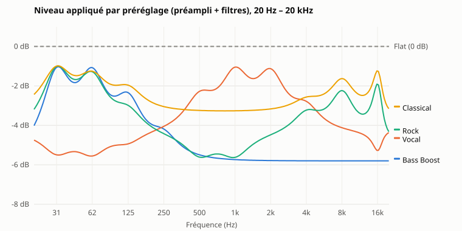

# Préréglages de l'égaliseur graphique : résumé (V2.4.3-B4)

Résumé public. Le journal de développement et de validation détaillé reste privé.

## Fonctionnement

- **Six touches** dans la carte « Égaliseur graphique » : Flat, Bass Boost, Vocal, Rock, Classical et Custom. La touche du réglage courant est allumée.
- **Equalizer APO uniquement.** Un préréglage n'écrit que `devialet-eq.txt`. Il n'envoie aucune requête aux enceintes : ni BASS, ni TREBLE, ni VOLUME. C'est vérifié par les tests.
- **Une seule source de vérité.** Le préréglage courant et la mémoire Custom sont dans la ligne `# devialet-state:` de `devialet-eq.txt`.
- **Curseur.** Déplacer un curseur passe en **Custom**, sauf si la courbe obtenue est exactement celle d'un préréglage.
- **Custom** rappelle le dernier réglage manuel, conservé même après un préréglage ou Réinitialiser. La touche reste grisée tant qu'aucun réglage manuel n'existe.
- **Activé ou Désactivé** est conservé quand on change de préréglage.
- **Clics rapides.** Les touches sont verrouillées pendant un envoi, et les écritures sont sérialisées côté serveur. Une révision optimiste refuse d'écraser une modification faite ailleurs.

## Courbes

Gains en dB, filtres en cloche, Q 1,41.

| Préréglage | 31 | 62 | 125 | 250 | 500 | 1k | 2k | 4k | 8k | 16k | Préampli |
|---|---|---|---|---|---|---|---|---|---|---|---|
| Flat | 0 | 0 | 0 | 0 | 0 | 0 | 0 | 0 | 0 | 0 | 0 dB |
| Bass Boost | +4 | +3,5 | +2,5 | +1 | 0 | 0 | 0 | 0 | 0 | 0 | −5,8 dB |
| Vocal | −1 | −1 | −0,5 | 0 | +1,5 | +2,5 | +2,5 | +1 | 0 | −1 | −4,3 dB |
| Rock | +3 | +2,5 | +1 | 0 | −1 | −1 | 0 | +1 | +2 | +2,5 | −4,5 dB |
| Classical | +2 | +1,5 | +1 | 0 | 0 | 0 | 0 | +0,5 | +1,5 | +2 | −3,3 dB |
| Custom | dernier réglage manuel | | | | | | | | | | calculé |

- **Calcul du préampli** : opposé du pic de la réponse cumulée des dix filtres, plus 1 dB de marge, ou 0 s'il n'y a aucune amplification. Le niveau appliqué ne dépasse donc jamais −1 dB : aucune fréquence n'est amplifiée par rapport au son sans égaliseur.
- **Contrepartie** : un préréglage paraît plus faible que Flat, de 3 à 6 dB environ. Aucune compensation automatique du volume n'est faite.

## Changements de niveau

Pour chaque action, le serveur calcule le niveau appliqué avant et après, sur 240 fréquences de 20 Hz à 20 kHz, et retient la plus forte hausse.

- **Entre préréglages**, ou en désactivant l'égaliseur, la hausse ne dépasse jamais **5,8 dB** : aucune confirmation n'est demandée.
- **Au-delà de 6 dB**, ce qui n'arrive qu'après un réglage manuel marqué :
  - Préréglage, Réinitialiser, Activé et Désactivé sont refusés avec `409 confirm` ;
  - l'interface affiche « Hausse de niveau », avec le focus sur **Annuler** ;
  - « Appliquer quand même » renvoie la demande avec la révision ; si le fichier a changé entre-temps, la réponse est un conflit.
- Le contrôleur **ne modifie jamais le volume** des enceintes de lui-même.
- **Pas de transition progressive.** Equalizer APO recharge le fichier en entier, en une à deux secondes, sans interpolation. Une rampe par paliers serait lente et saccadée, et sa fiabilité n'est pas démontrée.

| Réglage manuel (exemple) | Préampli | Hausse au retour à Flat |
|---|---|---|
| +6 dB à 4 kHz | −7 dB | +7 dB |
| +12 dB à 1 kHz | −13 dB | +13 dB |
| −12 dB à 1 kHz | 0 dB | +12 dB (une coupure retirée) |
| −12 dB sur 31, 62, 125 et 250 Hz | 0 dB | +17,5 dB (les coupures voisines s'additionnent) |

## API

| Méthode | Chemin | Corps |
|---|---|---|
| POST | `/api/eq/preset` | `{"preset": "flat" \| "bass-boost" \| "vocal" \| "rock" \| "classical" \| "custom", "revision"?, "confirm"?: bool}` |
| POST | `/api/eq/reset`, `/enable`, `/disable` | champ `confirm` facultatif |
| GET | `/api/eq` | champs `presets`, `custom` et `jumpLimitDb` |

Le nom du préréglage est validé par un motif strict. Aucun chemin ni aucune commande Equalizer APO n'est accepté. `config.txt` n'est jamais écrit.

## Validation

- **Tests automatisés** : chaque préréglage, retour à Flat, Custom, persistance, clics rapides, conflits, confirmation, erreurs d'écriture, `config.txt` intact, aucune requête vers les enceintes.
- **Scénario dans Edge**, avec des enceintes simulées et un dossier temporaire. Quatre thèmes, de 1280 à 360 px.
- **Essai d'écoute sur une paire Phantom II réelle**, confirmé par l'utilisateur : chaque préréglage s'entend, le retour à Flat fonctionne, ainsi que la mémoire Custom après rechargement. Aucune mesure acoustique n'a été faite.

## Limites

- **Curseurs sans confirmation.** Ramener vite une bande très amplifiée, ou supprimer une forte coupure, peut faire monter le niveau de plus de 6 dB en un rechargement.
- **Changement instantané**, une à deux secondes après le clic. Un léger clic au rechargement d'Equalizer APO n'a pas été mesuré.
- **Transitoires.** Le préampli protège le régime établi, pas les crêtes dues à la phase des filtres.
- **Tactile réel** non validé.
